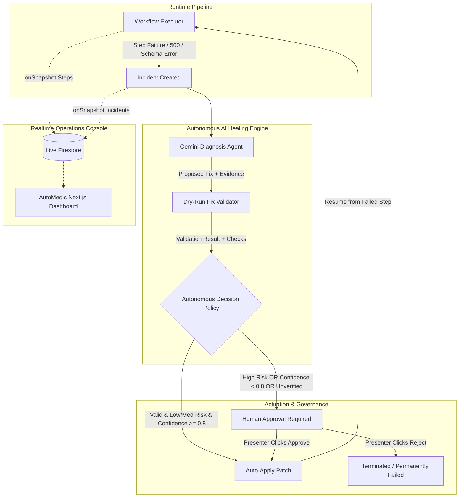

# AutoMedic: Self-Healing AI Workflow Runtime

**AutoMedic** is an autonomous self-healing execution engine designed to eliminate brittle point-to-point automation pipelines. When multi-step business workflows encounter runtime anomalies—such as upstream schema drift, silent type mutations, transient outages, or decoy fields—AutoMedic captures the exact execution state, invokes Google Gemini to diagnose root causes and synthesize non-destructive configuration patches, validates candidate fixes through a deterministic dry-run sandbox, and either auto-applies safe fixes or escalates high-risk mutations to human operators with one-click authorization.

---

## Architecture Diagram



---

## Setup in Under 5 Commands

```bash
# 1. Clone repository & enter directory
cd Code-e-fiesta-project

# 2. Install dependencies
npm install

# 3. Configure environment variables (create .env.local)
cp .env.example .env.local

# 4. Start local development server
npm run dev
```

### Environment Variables

| Variable | Required | Context | Description |
|---|---|---|---|
| `GEMINI_API_KEY` | Yes (or fallback) | Server | Google Gemini API Key for autonomous diagnosis |
| `GEMINI_MODEL` | Optional | Server | Model tag (defaults to `gemini-3.5-flash`) |
| `DEMO_FORCE_CACHE` | Optional | Server | Set to `true` for 100% offline demo mode (skips Gemini) |
| `ABSTRACT_API_KEY` | Optional | Server | Abstract API Company Enrichment key |
| `HUNTER_API_KEY` | Optional | Server | Hunter.io API key (alternative enrichment provider) |
| `HUBSPOT_TOKEN` | Optional | Server | HubSpot Private App Access Token (`crm.objects.contacts.write`) |
| `GOOGLE_SHEET_ID` | Optional | Server | Google Sheet ID for append fallback (shared with `FIREBASE_CLIENT_EMAIL`) |
| `RESEND_API_KEY` | Optional | Server | Resend API key for follow-up emails |
| `RESEND_FROM_EMAIL`| Optional | Server | Verified sender email for Resend (e.g. `onboarding@resend.dev`) |
| `EMAILJS_SERVICE_ID` | Optional | Server | EmailJS Service ID (alternative email provider) |
| `EMAILJS_TEMPLATE_ID` | Optional | Server | EmailJS Template ID |
| `EMAILJS_PUBLIC_KEY` | Optional | Server | EmailJS Public Key / User ID |
| `EMAILJS_PRIVATE_KEY`| Optional | Server | EmailJS Private Key (accessToken) if security restricted |
| `WEBHOOK_SECRET` | Optional | Server | Shared secret for `x-webhook-secret` header on `POST /api/webhooks/lead` |
| `FIREBASE_PROJECT_ID` | Yes | Server | Firebase Project ID for `firebase-admin` |
| `FIREBASE_CLIENT_EMAIL` | Yes | Server | Firebase Service Account Email |
| `FIREBASE_PRIVATE_KEY` | Yes | Server | Firebase Service Account Private Key (`\n` escaped) |
| `NEXT_PUBLIC_FIREBASE_*` | Yes | Client | Public Firebase Client SDK config (API key, project ID, etc.) |
| `NEXT_PUBLIC_APP_URL` | Optional | Both | Base URL (defaults to `http://localhost:3000`) |

---

## Real Service Integrations & Fault Injection Proxy

AutoMedic's execution steps connect directly to real external platforms while maintaining rock-solid fault tolerance:

1. **Company Enrichment Adapter (`/lib/integrations/enrichment.ts`)**:
   - Calls **Abstract API Company Enrichment** or **Hunter.io** when configured.
   - Normalizes live responses to `{ company, employees, industry }` while preserving the exact raw upstream response in `step.output.rawResponse` so Gemini can inspect live payload drift.
   - If keys are omitted, seamlessly falls back to the local simulated mock.

2. **CRM Contact Adapter (`/lib/integrations/crm.ts`)**:
   - Creates or updates contacts directly in **HubSpot Contacts API v3** using a Private App token.
   - If HubSpot is unconfigured, falls back to appending rows directly into **Google Sheets** via signed service account JWTs (zero external SDKs required).
   - If unconfigured, falls back to the mock CRM simulator.

3. **Email Dispatch Adapter (`/lib/integrations/email.ts`)**:
   - Sends real transactional emails through **Resend API** or **EmailJS**.
   - Logs `request.mode = "real"` or `"mock"` on the step log for transparent verification.

4. **Fault Injection Proxy (`/lib/integrations/proxy.ts`)**:
   - Sits between the workflow engine and external adapters.
   - When Chaos Mode is `"none"`, requests pass straight through to real services unmodified.
   - When Chaos Mode is active (`schema_drift`, `transient_500`, `rate_limit`, `bad_type`, `primary_down`, `bad_fix_trap`), the proxy executes the real call first (capturing true upstream response telemetry) and then injects the degradation, enabling realistic self-healing demonstrations without corrupting live customer databases.

---

## Real Triggers & Ingestion Methods

### 1. Inbound Webhook (`POST /api/webhooks/lead`)

Send leads directly from external forms, webhooks, or Zapier:

```bash
curl -X POST http://localhost:3000/api/webhooks/lead \
  -H "Content-Type: application/json" \
  -H "x-webhook-secret: automedic-secret-key" \
  -d '{
    "name": "Devon Vance",
    "email": "devon@vance-biotech.com",
    "company": "Vance Biotech",
    "website": "https://vance-biotech.com"
  }'
```

### 2. Public Lead Submission Portal (`/lead`)

Visit `http://localhost:3000/lead` in your browser. This clean public form enables manual entry or one-click demo presets, instantly submitting to the webhook and linking to the live execution in the AutoMedic dashboard.

### 3. Batch CSV Ingestion

Click **"Import CSV"** in the top navigation bar of the dashboard. Upload or paste up to 50 leads with automatic client-side concurrency control (max 2 parallel runs) and pre-configured messy data scenarios (missing companies, invalid emails, schema oddities).


---

## Deploying Firestore Security Rules

To ensure client browsers can read real-time updates while strictly preventing unauthorized client-side mutations:

```bash
# Install Firebase CLI if not already installed
npm install -g firebase-tools

# Login to your Google / Firebase account
firebase login

# Deploy security rules defined in firestore.rules
firebase deploy --only firestore:rules
```

---

## How It Works

### 1. Autonomous Decision Policy & Thresholds

AutoMedic enforces strict risk and confidence guardrails before any fix touches a production payload:

| Proposed Fix Type | Default Risk | Auto-Apply Allowed? | Policy Thresholds |
|---|---|---|---|
| `retry_with_backoff` | **Low** | Yes (Autonomous) | Validator passes, confidence $\ge 0.80$ |
| `switch_to_fallback_endpoint`| **Low** | Yes (Autonomous) | Target endpoint responds 200, confidence $\ge 0.80$ |
| `remap_field` | **Medium** | Yes (Autonomous) | Schema dry-run passes, confidence $\ge 0.85$ |
| `coerce_type` | **Medium / High** | **No** (Human Approval) | Requires operator authorization |
| `skip_step` | **High** | **No** (Human Approval) | Requires operator authorization |
| `manual_intervention` | **Critical** | **No** (Human Escalation) | Unresolvable anomaly; alerts on-call |

- **Re-Diagnosis Loop**: If Gemini proposes a fix that fails validator checks, AutoMedic feeds the exact validator failure back to Gemini for one bounded re-diagnosis attempt.
- **Fail-Safe Watchdog**: A 20-second watchdog timer guarantees that if AI diagnosis or network requests hang, the incident falls back to `pending`, the run transitions to `awaiting_approval`, and the system logs `autobot:watchdog`. Nothing hangs indefinitely.

### 2. Guardrail Validator Checks per Fix Type

Every fix is tested in a sandbox dry-run against captured response data before execution:
- **`remap_field`**:
  1. Source field exists in captured raw body.
  2. Target field is expected by the step's zod output schema.
  3. Transformed payload validates cleanly against step schema.
  4. Type compatibility check (e.g., source string cannot map to target integer).
- **`coerce_type`**:
  1. Field exists in captured body.
  2. Value can be safely coerced without precision loss or `NaN`.
  3. Coerced payload satisfies downstream schema requirements.
- **`retry_with_backoff`**:
  1. HTTP error was transient (500, 502, 503, 504, or 429).
  2. Backoff delay $\le 30000$ ms and max retries $\le 5$.
- **`switch_to_fallback_endpoint`**:
  1. Primary returned 503, 504, or network timeout.
  2. Fallback endpoint is healthy (checked via dry-run probe).

---

## 90-Second Stage Demo Script

| Timestamp | Presenter Action | On-Screen Visual | Talking Points |
|---|---|---|---|
| **00:00 - 00:15** | Click **"Run Demo"** in bottom bar | Baseline Run #1 completes with all green steps | *"Pipelines fail silently every day. AutoMedic provides an autonomous immune system for cloud automations. Here is our normal lead intake running end-to-end."* |
| **00:15 - 00:30** | Auto-transitions to Step 2 (`schema_drift`) | Run #2 fails at enrichment, auto-heals via `remap_field` | *"The third-party API silently renamed 'employees' to 'staff_count'. AutoMedic detects the schema break, Gemini analyzes the payload, the validator verifies the fix, and it self-heals in 1.4 seconds."* |
| **00:30 - 00:45** | Auto-transitions to Step 3 (`transient_500`) | Run #3 encounters 500, auto-heals with exponential backoff | *"Downstream services experience blips. Instead of failing the customer lead, AutoMedic applies intelligent backoff and automatically resumes."* |
| **00:45 - 01:05** | Auto-transitions to Step 4 (`bad_type`). Dashboard pauses with amber prompt | Run #4 pauses at `awaiting_approval`. Presenter clicks **"Approve Fix"** in right panel | *"Not all fixes should be auto-applied. Here the API returned string 'approx 50'. AutoMedic's policy detects a high-risk type coercion and requests human authorization. I click Approve, and execution resumes immediately."* |
| **01:05 - 01:20** | Auto-transitions to Step 6 (`bad_fix_trap`). Dashboard pauses | Run #5 pauses. Right panel shows validator blocked decoy field `employee_count_old`. Presenter clicks **"Reject"** | *"Here is the critical differentiator: guardrails. The upstream API sent a deprecated trap field. The AI attempted to use it, but our deterministic validator caught the error and blocked it. I click Reject to safely terminate."* |
| **01:20 - 01:30** | Step 7 summary card appears | Telemetry banner shows total runs, auto-healed, human-approved, and MTTR | *"AutoMedic delivers autonomous self-healing with zero unverified mutations and deterministic human-in-the-loop oversight."* |

---

## Honest Limitations & Next Steps

1. **Simulated External APIs**: The mock endpoints under `/api/mock/*` replicate real-world schema drift and outages. In production, AutoMedic connects to webhook proxies and API gateways (e.g. Stripe, Salesforce, HubSpot).
2. **Single Workflow Architecture**: AutoMedic currently demonstrates the `lead_to_crm` four-stage DAG. The executor abstraction is designed to parse arbitrary JSON DAG definitions with parallel branching.
3. **Demo-Grade Firestore Rules**: While client writes are completely blocked and read access is public for demo clarity, production deployments should incorporate Firebase Authentication (`request.auth != null`) and RBAC tenant isolation.
